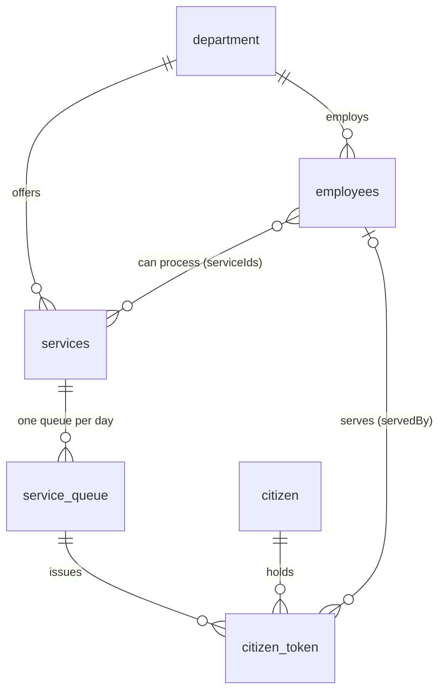

# Virtual Token System: DB Fields and App Scope (Hackathon)

Citizens book a virtual token remotely and arrive only when their turn is near. The system predicts the wait from service time, staff available, working hours, week-offs, leave, applicants so far, cutoff time and the daily limit.

**Stack assumptions:** MongoDB, two Next.js apps (`frontdesk`, `backoffice`) sharing one database.

| App | Users | Purpose |

|---|---|---|

| `frontdesk` | Citizens | Book a token, pick a date, track live position and ETA |

| `backoffice` | Staff (ADMIN, OFFICER) | Configure departments, services, staff and leave; run the queue |

**Decisions locked in**

- Tokens are **remote only** (no walk-ins).

- A citizen **picks the date** within each service's booking window.

- Alerts go out by **email, SMS or WhatsApp**, per the citizen's preference.

- Citizen login is **phone + password** (OTP is out of scope).

- Staff **mark ARRIVED** and **call the lowest ARRIVED token**.

- **ADMIN** configures; **OFFICER** operates the queue for services assigned to them.

- The **notifier job lives in `backoffice`**.

---

## 1. Conventions

- `_id` is an ObjectId on every collection. All collections also carry `createdAt` and `updatedAt`.

- Calendar dates are `"YYYY-MM-DD"` strings and times of day are `"HH:mm"` strings, interpreted in `department.timezone`. Exact moments (`estimatedServeAt`, `arrivedAt`, ...) are real `Date`s.

- Weekdays are numbers: 0 = Sunday ... 6 = Saturday.

- Collection names: `department`, `services`, `employees`, `citizen`, `service_queue`, `citizen_token`.

---

## 2. Collections and fields

### `department`

| Field | Type | Req | Notes |

|---|---|---|---|

| `name` | string | yes | |

| `code` | string | yes | Unique, e.g. `RTO` |

| `address` | string | no | |

| `city` | string | no | |

| `workingHours.start` | string `HH:mm` | yes | Opening time |

| `workingHours.end` | string `HH:mm` | yes | Closing time |

| `weekOffDays` | number[] | yes | Default `[0, 6]` |

| `holidays` | `{ date, name }[]` | no | Default `[]`. Public holidays, embedded |

| `timezone` | string | yes | IANA zone, e.g. `Asia/Kolkata` |

| `isActive` | boolean | yes | Default `true` |

### `services`

| Field | Type | Req | Notes |

|---|---|---|---|

| `departmentId` | ObjectId, FK `department` | yes | |

| `name` | string | yes | |

| `code` | string | yes | Unique within the department |

| `description` | string | no | Shown to citizens |

| `avgServiceMinutes` | number | yes | Average time to complete one application, must be > 0 |

| `cutoffTime` | string `HH:mm` | yes | Last time of day this service accepts or serves tokens; at or before `department.workingHours.end` |

| `dailyTokenLimit` | number | yes | Max tokens accepted per day |

| `bookingWindowDays` | number | yes | How many days ahead a citizen can book. Default `7` |

| `isActive` | boolean | yes | Default `true` |

### `employees`

| Field | Type | Req | Notes |

|---|---|---|---|

| `departmentId` | ObjectId, FK `department` | yes | |

| `name` | string | yes | |

| `email` | string | yes | Unique. Staff login identity |

| `role` | `ADMIN` or `OFFICER` | yes | ADMIN configures; OFFICER operates the queue |

| `serviceIds` | ObjectId[], FK `services` | yes | Services this employee can process (many-to-many) |

| `leaves` | `{ from, to, reason }[]` | no | Default `[]`. Full days, inclusive, always approved, so no status |

| `isActive` | boolean | yes | Default `true` |

Also store whatever credential field your auth library needs (for example `passwordHash`).

### `citizen`

| Field | Type | Req | Notes |

|---|---|---|---|

| `name` | string | yes | |

| `phone` | string | yes | Unique, E.164 (e.g. `+14155550123`) so SMS and WhatsApp work. Login identity |

| `passwordHash` | string | yes | Login credential. Not returned by queries unless selected (`select: false`) |

| `email` | string | no | Required when `EMAIL` is a chosen channel |

| `notifyChannels` | (`EMAIL` \| `SMS` \| `WHATSAPP`)[] | yes | Default `["SMS"]` |

| `phoneVerified` | boolean | no | Default `false`. Reserved for future OTP; unused in the POC |

### `service_queue`

One document per service per date. Created lazily on the first booking for that date. It holds the live counters, so the "now serving" board is a single read.

| Field | Type | Req | Notes |

|---|---|---|---|

| `serviceId` | ObjectId, FK `services` | yes | |

| `departmentId` | ObjectId, FK `department` | yes | Denormalized for dashboards |

| `date` | string `YYYY-MM-DD` | yes | Unique together with `serviceId` |

| `status` | `OPEN` \| `PAUSED` \| `CLOSED` | yes | Default `OPEN` |

| `activeEmployees` | number | yes | Employees on duty that day (see section 5) |

| `capacity` | number | yes | Max tokens that fit that day (see section 5) |

| `issuedCount` | number | yes | Non-cancelled tokens accepted. Default `0`; +1 on booking, -1 on cancel |

| `lastTokenNumber` | number | yes | Token sequence, never decreases. Default `0` |

| `nowServing` | number | yes | Highest token number called so far (progress marker). Default `0` |

| `completedCount` | number | yes | Default `0` |

### `citizen_token`

| Field | Type | Req | Notes |

|---|---|---|---|

| `citizenId` | ObjectId, FK `citizen` | yes | |

| `queueId` | ObjectId, FK `service_queue` | yes | |

| `serviceId` | ObjectId, FK `services` | yes | Denormalized for "my tokens" lookups |

| `servedBy` | ObjectId, FK `employees` | no | Set when called |

| `date` | string `YYYY-MM-DD` | yes | Copy of the queue date |

| `tokenNumber` | number | yes | Unique within the queue |

| `status` | enum | yes | `WAITING`, `ARRIVED`, `IN_SERVICE`, `COMPLETED`, `NO_SHOW`, `CANCELLED`. Default `WAITING` |

| `estimatedServeAt` | Date | yes | Set at booking; refreshed by the notifier |

| `bookedServeAt` | Date | yes | ETA promised at booking, never refreshed. Used for the ETA-accuracy metric |

| `notifiedAt` | Date | no | When the arrive-soon alert was sent. Empty until then |

| `notifications` | `{ event, channel, status, sentAt, error? }[]` | no | Send log. `event`: `BOOKED`, `ARRIVE_SOON`, `CANCELLED`. `status`: `SENT` or `FAILED` |

| `arrivedAt` | Date | no | Set by staff |

| `startedAt` | Date | no | Set when called into service |

| `completedAt` | Date | no | Set on completion. Together with `startedAt` it gives the real service time |

---

## 3. Relations



---

## 4. Indexes

| Collection | Index | Why |

|---|---|---|

| `department` | unique `code` | |

| `services` | unique `(departmentId, code)` | |

| `employees` | unique `email`; `(departmentId, serviceIds)` | Login; "who can process this service" |

| `citizen` | unique `phone` | Login by phone |

| `service_queue` | unique `(serviceId, date)` | One queue per service per day |

| `citizen_token` | unique `(queueId, tokenNumber)` | No duplicate numbers |

| `citizen_token` | `(queueId, status, tokenNumber)` | "Next to call", people-ahead count |

| `citizen_token` | `(citizenId, date)` | "My tokens" |

| `citizen_token` | partial unique `(citizenId, queueId)` while status is `WAITING`, `ARRIVED` or `IN_SERVICE` | One live token per citizen per service per day |

---

## 5. Booking and prediction rules

**Active employees for a date** = employees with `isActive`, the service in `serviceIds`, and no leave covering that date. A date that is a week-off or holiday is never bookable.

**Capacity** = `min(dailyTokenLimit, floor(activeEmployees x working minutes until cutoffTime / avgServiceMinutes))`. For today, "working minutes" are those left from now; for future dates it is the full window from opening to `cutoffTime`.

**Bookable dates** for a service: each day within `bookingWindowDays` that is not a week-off or holiday, has `activeEmployees > 0`, and has `capacity - issuedCount > 0`. If that day's `service_queue` does not exist yet, compute capacity on the fly with the formula above.

**Estimated wait** = `floor(peopleAhead / activeEmployees) x avgServiceMinutes` (corrected from `ceil`: officers serve in parallel, so with 2 officers the 2nd person in line is served straight away; implemented in `lib/queue-core.ts`). `peopleAhead` = tokens in the queue with status `WAITING`, `ARRIVED` or `IN_SERVICE` and a lower `tokenNumber`. `estimatedServeAt = max(now, opening time) + wait`.

**Issuing a token**

1. Upsert the `service_queue` for the chosen date.

2. Do one atomic update on it: increment `issuedCount` and `lastTokenNumber`, guarded by `issuedCount < capacity`. This prevents overbooking and duplicate numbers. If the guard fails, the date is full.

3. Insert the `citizen_token` with the new `tokenNumber` and `estimatedServeAt`, then send the `BOOKED` notification.

**Cancelling**: set status `CANCELLED`, decrement `issuedCount`, send `CANCELLED`. The token number is not reused.

**Recompute**: whenever a leave is added or removed, recompute `activeEmployees` and `capacity` on any existing queue for the affected dates.

**Notifier (every minute, in `backoffice`)**: for each OPEN queue dated today, take the `WAITING` tokens with `notifiedAt` empty and compute each one's live ETA from its position. If `ETA - travel buffer <= now` (the buffer is an app constant, e.g. 30 minutes), send `ARRIVE_SOON` on the citizen's channels, set `notifiedAt`, and log it in `notifications`. It also refreshes `estimatedServeAt`.

---

## 6. Token lifecycle

```

WAITING --(staff marks arrival)--> ARRIVED --(officer calls next)--> IN_SERVICE --(done)--> COMPLETED

   |

   +--(citizen cancels)--> CANCELLED

   +--(turn passes, never arrived; staff marks)--> NO_SHOW

```

| Transition | Done by | Fields set |

|---|---|---|

| `WAITING` to `ARRIVED` | Staff | `arrivedAt` |

| `ARRIVED` to `IN_SERVICE` | Officer, "call next" = lowest `tokenNumber` with status `ARRIVED` | `servedBy`, `startedAt`; `service_queue.nowServing` set to this number |

| `IN_SERVICE` to `COMPLETED` | Officer | `completedAt`; `service_queue.completedCount` +1 |

| `WAITING` to `NO_SHOW` | Staff | Frees the slot in the live queue (counts no longer include it) |

| `WAITING` to `CANCELLED` | Citizen (or staff) | `service_queue.issuedCount` -1 |

---

## 7. Scope: `frontdesk` (citizen app)

**In scope**

1. **Signup and login:** sign up with name, phone, password, notification channels and an optional email; log in with phone + password.

2. **Browse:** departments, then services (shows average time and cutoff).

3. **Pick a date:** list the bookable dates for the chosen service with remaining slots; hide week-offs, holidays and full days.

4. **Book:** create the token; show token number and estimated serve time. A `BOOKED` alert is sent.

5. **My tokens:** upcoming and past tokens.

6. **Live status page** for a token: position, people ahead, live ETA and what is now being served, refreshed by polling every 10 to 15 seconds.

7. **Cancel** a token while it is `WAITING`.

**Collections touched:** reads `department`, `services`, `service_queue`, `employees` (for availability only; server-side); writes `citizen`, `citizen_token` (create, cancel) and `service_queue` (upsert and atomic counters).

## 8. Scope: `backoffice` (staff app)

**In scope: ADMIN**

1. **Login** (role-based).

2. **Departments:** hours, week-offs, holidays, timezone.

3. **Services:** average minutes, cutoff time, daily limit, booking window, active flag.

4. **Employees:** create, assign services (`serviceIds`), set role, active flag.

5. **Leaves:** add or remove employee leave. This triggers the recompute from section 5.

**In scope: OFFICER**

1. **Queue console** for today, limited to the services in their `serviceIds`: tokens grouped by status.

2. **Actions:** mark `ARRIVED`, call next, complete, mark `NO_SHOW`, pause, close or reopen the queue.

**In scope: both**

- **Basic dashboard:** per service today, issued vs capacity, waiting, in service, completed.

**Background:** the notifier job described in section 5, including the email, SMS and WhatsApp send calls.

**Collections touched:** writes `department`, `services`, `employees`, `service_queue` (status, counters, recompute) and `citizen_token` (status changes, `servedBy`, timestamps, `notifications`); reads `citizen` (name, phone and channels for display and alerts).

## 9. Who writes what

| Collection | `frontdesk` | `backoffice` |

|---|---|---|

| `department` | read | write (ADMIN) |

| `services` | read | write (ADMIN) |

| `employees` | read (availability) | write (ADMIN) |

| `citizen` | write | read |

| `service_queue` | upsert, counters on book and cancel | status, nowServing, completedCount, recompute |

| `citizen_token` | create, cancel | status transitions, `servedBy`, timestamps, notifications |

## 10. Out of scope for the hackathon

OTP or hardened auth, walk-in tokens, lunch breaks, per-employee shifts or week-offs, multiple branches or counters, document checklists, feedback and payments, ML-based prediction, audit logs, multiple languages, rescheduling (cancel and rebook instead), and automatic no-show after a grace period.

**Stretch goals, in order:** a public "now serving" display screen; recompute `avgServiceMinutes` from completed tokens (`completedAt - startedAt`); QR check-in for arrival; reschedule.

## 11. Suggested build order

1. Define the models and indexes; seed one department, a few services and employees.

2. `backoffice`: department, service, employee and leave screens.

3. The shared core: availability, capacity and token issuing (section 5).

4. `frontdesk`: login, browse, pick date, book, my tokens, live status, cancel.

5. `backoffice`: queue console and dashboard.

6. Notifier job and the email, SMS and WhatsApp providers.

7. Stretch goals.

## 12. Things to settle early

- **Shared code across two repos.** Both apps write to `service_queue` and `citizen_token`, so keep the models and the booking and capacity logic in one place to avoid drift. Options: a small shared package, or `backoffice` calls a `frontdesk` API for booking-related actions.

- **WhatsApp** needs a pre-approved message template and user opt-in. For the hackathon use the Twilio WhatsApp sandbox; SMS and email are quicker to wire up.

- **Timezone** must be set per department; it decides which dates count as "today" and when the cutoff passes.
